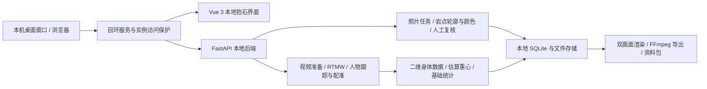

# 攀岩助手 · 本地抱石 App

一个在自己电脑上运行的抱石照片选线与视频复盘工具。用照片保存自己的线路，用视频观察骨架、二维估算重心与基础身体数据，并导出复盘视频或「视频＋全部资料」。

**当前公开版本：2026-10-10 源码预览版，来自本地 App `0.1.14-replay.20261009`。** 本仓库包含当前工作区更新，原始提交基线与导出范围见 [SOURCE_SNAPSHOT.json](SOURCE_SNAPSHOT.json)。本地版关闭云端收费 API，不需要填写 AI 密钥。

发布页提供**源码＋预构建界面包**，安装后可运行；它不是已完成独立电脑验收的免安装 EXE。骨架模式可由安装脚本准备；照片岩点识别还需要自行取得合法的专项模型权重并安装 Detectron2。下载包不会包含模型、Python、Node.js 或个人素材。完整限制见下文和 [模型安装说明](docs/MODELS.md)。

## 目录

- [当前功能](#当前功能)
- [下载、安装与启动](#下载安装与启动)
- [使用步骤](#使用步骤)
- [项目架构](#项目架构)
- [开源依赖、引用与原创部分](#开源依赖引用与原创部分)
- [目前能做到的程度](#目前能做到的程度)
- [数据、隐私和安全](#数据隐私和安全)
- [开发与验证](#开发与验证)
- [常见问题](#常见问题)
- [后续方向与参与](#后续方向与参与)
- [许可证](#许可证)

## 当前功能

| 功能 | 当前行为 | 使用条件 |
| --- | --- | --- |
| 照片选线 | 上传照片 → 整图识别候选岩点 → 自己逐点选线 → 复核保存 | 需专项岩点模型和 Detectron2 |
| 岩点编辑 | 补点、删点、单帧精修、画线圈选与确认轮廓 | 识别与模型辅助精修需要岩点模型 |
| 线路库 | 保存个人照片线路卡片，查看历史线路与进度 | 数据存放在当前电脑 |
| 视频准备 | 从画面取色、识别和复核岩点，或选择「只生成骨架」 | 岩点可选；纯骨架不依赖专项岩点模型 |
| 本地骨架 | RTMW-L 全身关键点、人物跟踪、墙面配准 | 需 RTMW 和 YOLOX 模型，支持 CPU；Windows 可用 DirectML |
| 同尺度双画面 | 左侧原视频，右侧骨架、当前岩点与随播放累积的估算重心路线 | 缺测和配准失败留空；回拖不展示未来轨迹 |
| 基础统计 | 时间、关节角度、躯干倾角、姿态停留和二维估算重心等 | 基于本地识别结果；不是专业准确率承诺 |
| 岩点使用显示 | 根据有证据的使用记录标亮；最后一帧显示有有效使用记录的全部岩点 | 纯骨架模式不计算或展示岩点接触统计 |
| 视频导出 | 复盘视频 / 视频＋全部资料；保留范围与速度选择 | FFmpeg 由用户环境安装；新导出另存 |
| 资料导出 | 随视频导出结构化分析资料、证据及分析约束，供自行检查或交给自己的 AI | App 本身不发送到外部 AI |
| 文件存储 | 桌面窗口可选择空文件夹，下次启动复制资料并切换，保留原资料 | 配置位置不迁移；浏览器模式不提供原生文件夹选择 |
| 本地账号 | 单机 owner 身份、设置中的账号与退出入口 | 不提供多人账号隔离或公网登录服务 |

旧生产系统的定线工作区、仿真审核、AI 实验室与服务器发布工具不属于本仓库。源码保留了一些历史分析兼容模块，但当前界面和后端入口没有开放云端评语、专业动作点评、同线路比较或动作修正产品流程。

## 下载、安装与启动

### 1. 获取源码

**普通用户推荐：** 前往 [Releases](https://github.com/Huoxixi/ai-climbing-local/releases)，下载 `AiClimbing-local-*.zip`，解压后双击 `install.cmd`，完成后双击 `start.cmd`。这个压缩包带已构建界面，首次安装无需 Node.js。

**开发者：** 在 GitHub 点击 **Code → Download ZIP** 并解压，或：

```powershell
git clone https://github.com/Huoxixi/ai-climbing-local.git
cd ai-climbing-local
```

发布页提供同版本源码压缩包及 SHA-256 校验文件。程序源码与个人数据分别保存；不要解压覆盖自己的资料文件夹。

### 2. 安装运行环境

当前主支持平台为 **Windows 10/11 x64**。

- [Python 3.12 x64](https://www.python.org/downloads/windows/)：安装 Python Launcher；自定义 Python 路径也可通过 `setup.ps1 -Python` 指定。
- [Node.js](https://nodejs.org/en/download/)：仅开发者源码构建需要；22.12+ 的 22.x 或 24+，包含 npm。使用发布页的预构建界面包可跳过。
- [Microsoft WebView2 Evergreen Runtime](https://developer.microsoft.com/en-us/microsoft-edge/webview2/)：桌面窗口需要；浏览器模式可不依赖它。
- 首次安装需要联网下载依赖与约 265 MB 的姿态模型，实际下载体积还包括依赖、压缩包和视频编码工具。处理速度及内存占用取决于视频长度、分辨率和电脑配置；尚未给出经过跨机器验收的最低配置。

### 3. 一次安装

双击 `install.cmd`，或在源码目录执行：

```powershell
powershell -NoProfile -ExecutionPolicy Bypass -File .\setup.ps1
```

脚本在本目录创建 `.venv`，安装依赖，从 OpenMMLab 官方地址下载并校验 RTMW/YOLOX 模型。发布包的预构建界面通过清单校验后直接使用；只有纯源码下载或 `-RebuildFrontend` 才需要 Node.js 构建。脚本不读取旧开发目录，不复制你的照片或密钥，不请求任何收费 AI 服务。

自定义 Python：

```powershell
.\setup.ps1 -Python 'C:\Python312\python.exe'
```

模型已有或需要稍后自行安装时使用 `-SkipModels`。跳过安装不代表已具备姿态推理能力。

### 4. 启动

双击 `start.cmd` 打开独立桌面窗口。窗口关闭后本次后台服务退出。

也可运行浏览器模式：

```powershell
.\start.cmd --browser
```

浏览器模式中关闭网页不会结束后台；在启动终端按 `Ctrl+C` 退出。每次启动使用空闲的本地端口，不占用原项目端口。程序只监听 `127.0.0.1`，以实例凭证保护页面、API 与媒体。

默认资料位置为 `%LOCALAPPDATA%\AiClimbingCommunity`，与内部 App 的 `AiClimbing` 目录独立。指定新位置可用：

```powershell
.\start.cmd --data-root 'D:\MyClimbingData'
```

### 5. 可选：启用照片岩点识别

请按 [docs/MODELS.md](docs/MODELS.md) 安装 Detectron2 与专项权重。权重缺失时明确报错，不悄悄切换到云端，也不以随机轮廓冒充识别。Windows 的 Detectron2 编译需要额外工具链，本次公开包没有提供已编译的原生扩展。

## 使用步骤

**先体验纯骨架复盘：** 进入视频复盘 → 选择自己的视频 → 选择「只生成骨架」 → 开始本地分析 → 查看双画面和基础统计 → 导出复盘视频或视频＋全部资料。原视频保留；纯骨架模式不会生成岩点使用率。

**体验带岩点复盘：** 准备好专项模型后，从视频画面取色 → 上传并识别岩点 → 检查、补删和精修 → 确认岩点 → 开始本地分析。也可在识别后放弃岩点，继续生成骨架。

**保存照片线路：** 上传清晰的完整岩壁照片 → 整图识别 → 自选线路成员 → 对漏点和边缘进行精修 → 确认保存。当前默认路线为空，不自动假定所有同色岩点属于同一线路。

页面中的合成示例用于展示操作，不是训练数据、真实用户照片或识别准确率基准。

## 项目架构



```text
ai-climbing-local/
├── README.md / THIRD_PARTY_NOTICES.md / LICENSE
├── install.cmd / setup.ps1          首次安装与模型准备
├── start.cmd / run-local.py         同源页面、实例保护和窗口生命周期
├── SOURCE_SNAPSHOT.json             原始版本与公开范围
├── frontend/
│   ├── src/LocalRoot.vue            本地账号与入口
│   ├── src/LocalApp.vue             照片、线路库、复盘和设置
│   ├── src/components/              本地工作台、岩点编辑器、播放器
│   ├── src/services/                API、坐标、播放和数据处理
│   ├── src/styles/                  界面样式
│   └── package-lock.json            前端依赖锁定
├── backend/
│   ├── boulder_local_app.py         仅本地抱石 API，关闭收费入口
│   ├── core/photo_*.py              照片任务与专项实例分割适配
│   ├── core/climb_replay.py         视频任务、保存、恢复与基础处理
│   ├── core/replay_*.py             姿态、跟踪、统计、兼容、渲染和导出
│   ├── model_assets/                模型配置与摘要，不含模型权重
│   ├── vendor/rtmlib/               实际复用的推理辅助代码及原许可证
│   ├── scripts/install_replay_rtmw.py
│   └── requirements-local.txt       当前本地运行依赖
├── desktop/                        访问保护、存储配置与安全辅助
├── docs/                           模型、架构、验收与使用说明
└── .github/workflows/ci.yml         公开源码构建与针对性检查
```

前后端共用当前本地 App 代码。前端仅导出本地入口可达的文件；后端按本地包规则及导入关系收集，保留内部兼容能力不等于对外提供对应功能。Python 根依赖固定为当前已使用版本，间接依赖仍由 pip 解析；前端通过 `package-lock.json` 固定。完整架构说明见 [docs/ARCHITECTURE.md](docs/ARCHITECTURE.md)。

## 开源依赖、引用与原创部分

本项目不是从零实现姿态模型或实例分割模型。下面区分**实际复制/修改、运行依赖、外部权重和研究参考**，避免把所有调研过的仓库写成已经集成。

| 来源 | 实际关系 | 许可与说明 |
| --- | --- | --- |
| [rtmlib](https://github.com/Tau-J/rtmlib) | 实际保留 RTMPose/YOLOX 预处理与解码子集；BaseTool 改为仅本地 ONNX 适配 | Apache-2.0；原 LICENSE、下载摘要与修改 NOTICE 保留 |
| [MMPose / RTMW](https://github.com/open-mmlab/mmpose) | 使用官方 RTMW-L 384×288 导出权重；不打包完整 MMPose | 源码 Apache-2.0；权重及训练数据条件需分别查看 |
| [YOLOX](https://github.com/Megvii-BaseDetection/YOLOX) | OpenMMLab 提供的 YOLOX-S HumanArt 人体检测导出权重 | 源码 Apache-2.0；不把源码许可证直接等同于权重全部使用条件 |
| [ONNX Runtime](https://github.com/microsoft/onnxruntime) | CPU / Windows DirectML 推理依赖 | MIT |
| [Detectron2](https://github.com/facebookresearch/detectron2) | 岩点 Mask R-CNN 的可选推理框架；配置基于其结构 | Apache-2.0；已使用原生构建基线 `a2f4a877`；不分发编译二进制 |
| [Indoor Climbing Gym Hold And Route Segmentation](https://www.kaggle.com/datasets/tomasslama/indoor-climbing-gym-hold-segmentation) | Tomáš Sláma 的专项岩点分割模型与公开数据来源 | 本地来源记录写明数据元信息 CC BY-SA 4.0，研究源码 GPL-3.0；具体权重的再分发授权未完全核清，因此不上传权重 |
| [PyTorch](https://github.com/pytorch/pytorch) / [TorchVision](https://github.com/pytorch/vision) | 可选专项模型运行依赖 | 原 BSD 通知及各原生组件的第三方许可仍适用 |
| [Vue](https://github.com/vuejs/core)、[Vite](https://github.com/vitejs/vite)、[Element Plus](https://github.com/element-plus/element-plus)、[Axios](https://github.com/axios/axios) | 界面与通信依赖 | MIT |
| [FastAPI](https://github.com/fastapi/fastapi)、[Uvicorn](https://github.com/encode/uvicorn)、[Pydantic](https://github.com/pydantic/pydantic) | API、服务与数据校验依赖 | MIT / BSD-3-Clause / MIT |
| [pywebview](https://github.com/r0x0r/pywebview) | Windows 独立窗口 | BSD-3-Clause；WebView2 为外部微软组件 |
| [OpenCV](https://github.com/opencv/opencv)、[NumPy](https://github.com/numpy/numpy)、[Pillow](https://github.com/python-pillow/Pillow) | 视频图像、计算与绘图依赖 | Apache-2.0 / BSD-3-Clause / HPND；原生包另含第三方组件 |
| [imageio-ffmpeg](https://github.com/imageio/imageio-ffmpeg) / [FFmpeg](https://ffmpeg.org/) | 视频转码与导出；用户在自己环境安装 | 包装层 BSD-2-Clause；FFmpeg 具体构建可能是 GPL，不能用包装层许可证覆盖二进制 |
| [Noto CJK](https://github.com/notofonts/noto-cjk) | 后端中文文字渲染；保留原字体及许可证 | SIL OFL 1.1 |
| [MiSans](https://hyperos.mi.com/font/en/faq/) | 前端原版字体嵌入 | 小米字体条款；不是由本项目重新授权的自由字体 |

研究阶段还参考过 [vision-demos / rock_climbing](https://github.com/jeremyipark/vision-demos/tree/main/rock_climbing)、[Climbing Analysis Toolbox](https://github.com/tommyjtl/climbing-analysis-toolbox)、[PoseAnalysis](https://github.com/jayv29/pose-analysis-skill)、[Dynalytix](https://github.com/Jolieabadir/dynalytix) 的交互、视频对齐与数据表达思路；本次导出未发现这些仓库的 vendored 源码目录，不据此声称直接复制或已实现它们的全部功能。历史调研中对部分许可有相互冲突记录，因此这里只列研究参考，不作复制授权证明。

本项目主要实现照片/视频任务编排、人工复核工作流、人物跟踪约束与证据保存、坐标对齐、二维估算重心与统计表达、同尺度播放、历史恢复、导出和本地桌面数据隔离。它们建立在上述框架、模型与研究工作之上。完整出处和分发边界见 [THIRD_PARTY_NOTICES.md](THIRD_PARTY_NOTICES.md)。

## 目前能做到的程度

目前可以用它**整理自己的抱石线路，回看攀爬过程，并把视频和分析资料保存下来**。它已经能完成基础流程，但识别结果仍需要自己检查，暂时不能代替教练判断。

| 你想做的事 | 现在能做到什么 | 使用时需要知道什么 |
| --- | --- | --- |
| 从照片保存一条线路 | 找出候选岩点，由你选择线路、修正漏点和边缘，再保存 | 需要另装岩点识别模型；可能认错或漏掉岩点，保存前要确认 |
| 看清自己怎样移动 | 在视频旁显示身体骨架，辅助观察手脚位置、身体倾斜和姿态变化 | 默认每秒分析约 10 个画面；人物被遮挡、离开画面、旁人入镜或镜头晃动，都可能让结果不完整或认错人 |
| 观察身体中心的移动 | 根据画面中的身体姿态，估算一个中心点并显示它的移动路线 | 这是平面视频里的估算，不能说明真实的三维重心或手脚用了多大力；身体关键部位看不清时会留空 |
| 回顾哪些岩点可能用过 | 结合手脚位置和岩点位置，显示可能的接触、停留和使用记录 | 画面中手脚靠近岩点，不一定代表真正抓住或踩稳；纯骨架模式不提供这些记录 |
| 留下复盘资料 | 查看基础统计，导出复盘视频，或一起导出分析资料，方便之后回看 | 原视频与已有结果保留；导出需要电脑有足够的存储空间 |

**目前还不能做：** 自动判断线路难度、准确识别每一种攀岩技巧、给出教练级动作点评，或根据视频判断真实受力。当前公开版也没有云端 AI 点评、不同视频的技巧对比和自动定线仿真功能。

**安装和兼容性：** 骨架模式可按安装说明准备；照片识别还需要额外模型和运行组件。目前已在开发电脑上检查基本运行流程，但还没有完成不同电脑、显卡和所有视频格式的全面验证，使用中可能遇到兼容问题。详细检查记录见 [docs/VALIDATION.md](docs/VALIDATION.md)。

## 数据、隐私和安全

照片、视频、SQLite 数据库、任务状态和导出留在自己的电脑。运行时姿态推理不会自动下载模型；首次安装会访问 Python/npm 软件源与 OpenMMLab 模型地址。当前本地产品不发送媒体到付费 AI。

本仓库是新建源码快照，不携带旧 Git 历史、个人媒体、生产数据、密钥、服务器地址或访问配置。`.gitignore` 排除模型、虚拟环境、数据库、缓存和运行数据。提交贡献前仍需自己检查暂存内容；忽略规则不是秘密扫描的替代品。

默认数据是单机单用户目录，**不要把服务绑定公网或以它提供多人托管**。实例凭证不代替多租户权限体系。迁移只复制到选择的空目录，保留原文件；卸载源码前先备份资料目录。

## 开发与验证

运行依赖安装完成后：

```powershell
$env:LOCAL_ONLY='true'
$env:PYTHON_DOTENV_DISABLED='1'
$env:PYTHONPATH="$PWD;$PWD\backend"
.\.venv\Scripts\python.exe -m unittest discover -s backend -p 'test_boulder*.py'
.\.venv\Scripts\python.exe -m unittest desktop.test_storage desktop.test_package_scope
cd frontend
npm run build -- --mode boulder-local
```

公开 CI 验证 Linux 的源码构建、部分本地数据流程与分发范围，**不测试真实视频识别质量、Windows 原生窗口或专项 Detectron2 扩展**。后端单测使用临时目录与合成数据，不调用收费服务。

如使用 Vite 开发服务，应配置 `LOCAL_ONLY=true`、独立 `PHOTO_ROUTE_DATA_DIR`，启动 `boulder_local_app:app`，并保持本地来源约束。普通使用者直接使用 `start.cmd`，不需要分别启动前后端。

## 常见问题

| 问题 | 处理方法 |
| --- | --- |
| 缺少 Python / npm | 安装上述官方运行环境，重开终端；Python 必须 3.12 x64 |
| 安装失败或模型下载中断 | 查看安装末尾错误；重跑安装；校验失败文件不会被自动覆盖，先核实再处理 |
| 模型未准备好 | 执行 RTMW 安装；照片模型另按 MODELS.md 配置 |
| 照片识别不能运行 | 没有安装 Detectron2 / 专项权重不是可运行配置；先体验纯骨架模式 |
| 骨架不完整或人物选错 | 改善取景、减少旁观者和遮挡；不能用错误骨架推断技术 |
| 窗口打不开 | 安装 WebView2，或用 `start.cmd --browser` |
| 导出失败 | 检查可用磁盘、FFmpeg 与原视频；保留旧结果，失败不代表原片被删除 |
| 设置中不显示 AI 服务 | 当前本地范围已关闭这些接口，属于预期行为 |
| 更新后历史资料不见了 | 核对 `--data-root` 或默认 Community 目录；内部旧 App 目录不会自动导入 |

## 后续方向与参与

优先事项是独立 Windows 电脑安装验收、专项权重授权核实、可复现的 Detectron2 构建、视频覆盖测试和独立标注质量验证。在满足权重、字体、原生组件与 FFmpeg 源码分发条件后再提供完整免安装二进制。

欢迎通过 [Issues](https://github.com/Huoxixi/ai-climbing-local/issues) 报告系统版本、运行环境、复现步骤、预期/实际行为和经过脱敏的错误信息。不要上传密钥、含个人身份的媒体或完整资料目录。提交 PR 前阅读 [CONTRIBUTING.md](CONTRIBUTING.md)；安全问题见 [SECURITY.md](SECURITY.md)。

## 许可证

本项目代码采用 **GNU GPL v3.0**，详见 [LICENSE](LICENSE)。保留作者信息和修改说明；分发修改版时按许可证提供相应源码。实际 vendored 第三方代码、字体、外部模型和运行依赖保留各自许可，本项目许可证不能替它们重新授权。

这份公开源码不包含授权尚待核清的专项权重，也不分发 FFmpeg、Detectron2 原生扩展或打包 Python 运行时；下载依赖和外部模型不代表所有使用场景均已取得授权。上述来源作者不为本项目功能或结论背书。
